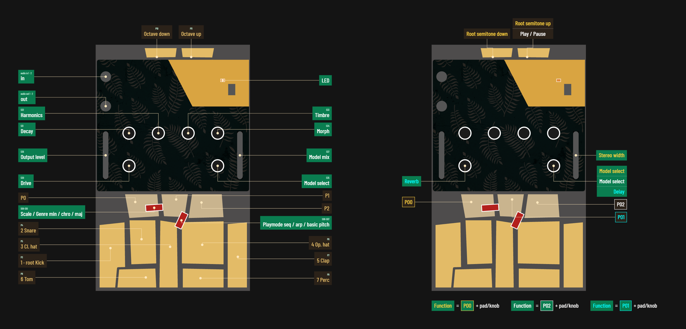

# TouchPlaited

Firmware for the Synthux Simple Touch: a 6-voice Plaits synth, an arpeggiator with a 2-bar note recorder and a 16-step generative drum sequencer, playable at the same time. Based on Mutable Instruments Plaits by Émilie Gillet.

<a class="cta" href="https://jonwaterschoot.github.io/TouchPlaited/play/">▸ Play it in the browser</a>

[Manual](MANUAL.md) · [Pattern editor](https://jonwaterschoot.github.io/TouchPlaited/editor/) · [Releases](../../releases) · [Simple Touch library](https://jonwaterschoot.github.io/simple-touch-labels/?community=touchplaited)

## Start simple

The firmware is finished, and it does more at once than it plays well. Drums under a melody run out of voices, and you hear notes being cut off. The controls take the manual and the OLED to learn.

The part that works best is the one the project started with: playing the Plaits models from the pads. I'd stick to that.

1. Flick SW2 down (Basic Pitch) and play P3–P9. P10 / P11 change the octave.
2. Hold P0 and turn S35 for models 0–11. Hold P2 and turn S35 for models 12–23.
3. Shape the sound with S31–S34: decay, harmonics, timbre, morph.

If the drums are running, hold P2 and tap P11 to pause them. A light version with only this mode would be the better firmware. This was my first Daisy project built by prompting, and it stays as it is.



## What it does

The right switch (SW2) picks the playmode:

- **Seq** (up): a 16-step drum sequencer with seven drums and patterns per genre (Techno, Electro, IDM).
- **Arp/Mel** (centre): an arpeggiator with hold, and a recorder that layers notes into a 2-bar loop.
- **Basic Pitch** (down): one Plaits model, played with the pads or over MIDI.

The drums and the arp keep playing when you switch modes. Each mode has its own sound, volume, reverb and delay.

- **Models**: 23 of the 24 Plaits models, picked with P0 or P2 held and S35.
- **Kick bank**: eleven fixed, named kicks (808s, 909s, a stacked one). Step through them with P0 + P10 / P11.
- **MIDI**: USB and TRS, in and out. Notes on channel 1, drums on channel 10, CC 20–31 and 85–88, clock in and out on MIDI and CV.
- **OLED** (optional, 128 × 32): names the control you touch and its value.
- **Settings memory**: sounds, kit and levels are saved a few seconds after the last change. [How it works](doc/settings-memory.md).

## First five minutes

```
            [ P10 ] [ P11 ]             down / up
        [ P0 ]  [ P1 ]  [ P2 ]          held pads: sound, FX, transport
[ P3 ]  [ P4 ]  [ P5 ]  [ P6 ]  [ P7 ]  notes or drums
            [ P8 ]  [ P9 ]
```

1. **Drums**: flick SW2 up. A kit is generated and the pattern starts. S31 is tempo, S33 density. SW1 picks the genre, S35 the pattern.
2. **Play the drums**: tap P3–P9.
3. **Pick a kick**: hold P0, tap P11 or P10.
4. **Add a synth**: flick SW2 down. The drums keep playing and P3–P9 play notes. Hold P0 or P2 and turn S35 for another model.
5. **Arpeggio**: flick SW2 to the centre and hold a few pads. Flick SW1 left to latch them.
6. **Pause the drums** from any mode: hold P2, tap P11.

The [manual](MANUAL.md) has every control per mode.

## Install

The firmware runs from QSPI flash, so the Seed needs the Daisy bootloader first (once per board).

**In the browser** (Chrome or Edge): open the [Play page](https://jonwaterschoot.github.io/TouchPlaited/play/) and press **Upload to device…**. It fetches the latest release, installs the bootloader if the board needs it, and writes the firmware.

<details>
<summary>With dfu-util</summary>

1. Bootloader, once per board. Hold BOOT, tap RESET, release BOOT. Then:

   ```bash
   curl -LO https://raw.githubusercontent.com/Synthux-Academy/libDaisy/62ab175533ce254cb353b60d8651310744b26a40/core/dsy_bootloader_v6_2-intdfu-2000ms.bin
   dfu-util -a 0 -s 0x08000000:leave -D dsy_bootloader_v6_2-intdfu-2000ms.bin -d ,0483:df11
   ```

2. Firmware, on every update. Tap RESET, then press BOOT while the LED pulses slowly (within 2 s). Download `TouchPlaited.bin` from the [releases](../../releases), then:

   ```bash
   dfu-util -a 0 -s 0x90040000:leave -D TouchPlaited.bin
   ```

The two button sequences differ. Hold BOOT and tap RESET for the chip's own DFU mode (step 1). Tap RESET and then BOOT for the Daisy bootloader (step 2).

</details>

<details>
<summary>Build from source</summary>

Needs the ARM GNU toolchain (`arm-none-eabi-gcc`), `make` and Python 3.

```bash
git clone https://github.com/jonwaterschoot/TouchPlaited.git
cd TouchPlaited
git submodule update --init --recursive
cd lib/libDaisy && make && cd ../..
make
make program-boot   # bootloader, once per board
make program-dfu    # firmware
```

The output is `build/TouchPlaited.bin`. After moving the libDaisy submodule, run `make -C lib/libDaisy` again. More in [thirdparty/README.md](thirdparty/README.md).

</details>

## On the web

- [Play](https://jonwaterschoot.github.io/TouchPlaited/play/): the firmware in the browser, on a drawing of the panel with its labels per mode, the OLED and MIDI. Also **Upload to device…**.
- [Pattern editor](https://jonwaterschoot.github.io/TouchPlaited/editor/): draw drum patterns on a 16-step grid with four chance levels, hear them, and save them as `.h` files for `synth/patterns/<genre>/`. A rebuild adds them to S35.
- [Visualizer](https://jonwaterschoot.github.io/TouchPlaited/visualizer/): follows a connected board over USB MIDI. For video overlays, see [visualizer/README.md](visualizer/README.md).
- [Code map](https://jonwaterschoot.github.io/TouchPlaited/codemap/): the hardware and memory layout of the firmware.

## Repository

<details>
<summary>Where everything is</summary>

| Path | Contents |
|------|----------|
| `TouchPlaited.cpp` | Main file: modes and state, calls everything below |
| `synth/` | Voice pool, Plaits integration, drum sequencer, arp, note recorder, FX, settings journal |
| `synth/patterns/` | Drum patterns as headers, one folder per genre |
| `synth/kick_presets.h` | The eleven kicks and their knob ranges |
| `touch/` | Pads, knobs and switches |
| `midi/` | USB and TRS MIDI, and the SysEx telemetry for the visualizer |
| `display/` | OLED driver, screens and boot animation |
| `thirdparty/`, `lib/` | Plaits (vendored), stmlib and libDaisy (submodules) |
| `simple-touch-labels.json`, `img/faceplate.jpg` | Labels, look and approved browser build, read by the [Simple Touch library](https://jonwaterschoot.github.io/simple-touch-labels/) and the Play page |
| `tools/` | Pattern editor, code map, `gen_patterns.py` |
| `visualizer/` | The visualizer, and `tools/build-site.mjs`, which builds this site |
| `doc/` | Site template and theme, [settings memory](doc/settings-memory.md) |
| `ROADMAP.md`, `notes.md`, `notesarchive/` | What is still open, the working log, and finished rounds |

</details>

## About

TouchPlaited was built by prompting. I supplied the instrument design and the hardware knowledge, and Claude (in VS Code) wrote the C++. The brief, the plan and a timeline are in [notesarchive/readme.md](notesarchive/readme.md).

Credits:

- Émilie Gillet / Mutable Instruments: [Plaits](https://github.com/pichenettes/eurorack/tree/master/plaits) and [stmlib](https://github.com/pichenettes/stmlib).
- shakfu: [sk-engines](https://github.com/shakfu/sk-engines), which put Plaits on a Daisy first.
- Vlad (Bleeptools) and [Synthux Academy](https://synthux.academy/): the Simple Touch, [TouchBass](https://github.com/Synthux-Academy/TouchBass) as the starting template, and their [libDaisy fork](https://github.com/Synthux-Academy/libDaisy).
- Electrosmith: the [Daisy Seed](https://electro-smith.com/) and [libDaisy](https://github.com/electro-smith/libDaisy).

## Licence

TouchPlaited is released under the [MIT License](LICENSE). [licenseinfo.md](licenseinfo.md) lists what it includes.

- Plaits (in `thirdparty/plaits/`, with [its licence](thirdparty/plaits/LICENSE)) and stmlib, © Émilie Gillet, MIT.
- libDaisy (Synthux fork), © Electrosmith, MIT. The visualizer's OLED font tables are copied from it.
- The Play page's code comes from [Simple Touch labels](https://github.com/jonwaterschoot/simple-touch-labels) and [simple-touch-web](https://github.com/jonwaterschoot/simple-touch-web), MIT.

Not under the MIT License: the Simple Touch panel drawing, © Roey Tsemah / [Synthux Academy](https://synthux.academy). That covers `img/simpletouchdrawing_blank.svg`, the `img/SimpleTouchDrawing/` exports and `.ai` files, `visualizer/assets/panel.svg`, and the screenshots that show it.
